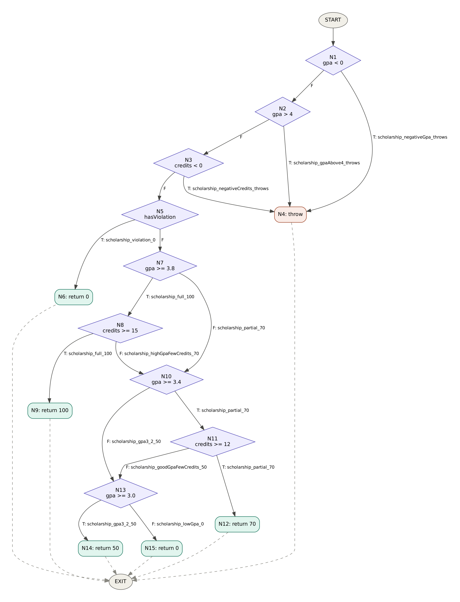

# Лаб 9: Код хамралт — JaCoCo-гоор тестээ хөтлөх

**F.CSA313 — Программ хангамжийн чанарын баталгаа ба тест (2026)**

- **Нэр:** Э.Батхүлэг
- **Оюутны код:** B232270040

## Орчин

```
$ java -version
java version "23.0.2" 2025-01-21
Java(TM) SE Runtime Environment (build 23.0.2+7-58)
Java HotSpot(TM) 64-Bit Server VM (build 23.0.2+7-58, mixed mode, sharing)

$ mvn -version
Apache Maven 3.9.16 (2bdd9fddda4b155ebf8000e807eb73fd829a51d5)
Maven home: D:\apache-maven-3.9.16-bin\apache-maven-3.9.16
Java version: 23.0.2, vendor: Oracle Corporation, runtime: D:\java
Default locale: en_US, platform encoding: UTF-8
OS name: "windows 11", version: "10.0", arch: "amd64", family: "windows"
```

Ажиллуулах: `mvn verify` → тайлан `target/site/jacoco/index.html`.

---

## Хэсэг A: Happy path тестүүд ба эхний хэмжилт

Зөвхөн хэвийн урсгалын 5 тест бичсэн (`ScholarshipCalculatorTest`):
`letterGrade_95_isA`, `letterGrade_85_isB`, `gpa_95_85_is3_5`, `scholarship_full_100`, `scholarship_partial_70`.

Үр дүн (`results/mvn-verify-A.txt`: `Tests run: 5`, `results/jacoco-A.csv`):

| Хэмжүүр | Covered | Missed | Хамралт |
|---|---|---|---|
| Line | 15 | 10 | 15/25 = **60%** |
| Branch | 20 | 21 | 20/41 ≈ **48.8%** |

**Шар/улаан мөрүүдийн ажиглалт.** Шар ромботой мөрүүд нь бүх `if`-ийн хамгаалалтын нөхцөлүүд (`score < 0 || score > 100`, `scores == null || scores.length == 0`, `gpa < 0 || gpa > 4 || credits < 0`) — тэдгээрийн зөвхөн "худал" салаа явсан; мөн `score >= 80`, `hasViolation`, `gpa >= 3.8 && credits >= 15`, `gpa >= 3.4 && credits >= 12` нөхцөлүүдийн нэг тал, `switch`-ийн 5 салаанаас зөвхөн A, B хоёр нь хамрагдсан.
Улаан (огт хүрээгүй) мөрүүд нь гурван `throw new IllegalArgumentException` буюу алдааны замууд, мөн доод дүн/тэтгэлгийн салаанууд: `return "C"`, `return "D"`, `return "F"`, `case "C"`, `case "D"`, `return 50`, сүүлийн `return 0`.
Өөрөөр хэлбэл happy-path тестүүд зөвхөн "сайн оюутан"-ы замыг шалгаж, буруу оролт ба бага дүнгийн бүх логикийг огт ажиллуулаагүй байна.

---

## Хэсэг B: CFG зурж branch 100% хүрэх

### `scholarship()`-ийн CFG



Зангилаанууд (нөхцөл бүрийг тусдаа шийдвэрийн зангилаа болгосон, учир нь JaCoCo `||`/`&&`-ийн нөхцөл бүрийг тусдаа салаа гэж тоолдог):

| Зангилаа | Код |
|---|---|
| N1 | `gpa < 0` |
| N2 | `gpa > 4` |
| N3 | `credits < 0` |
| N4 | `throw new IllegalArgumentException` |
| N5 | `hasViolation` |
| N6 | `return 0` (зөрчил) |
| N7 | `gpa >= 3.8` |
| N8 | `credits >= 15` |
| N9 | `return 100` |
| N10 | `gpa >= 3.4` |
| N11 | `credits >= 12` |
| N12 | `return 70` |
| N13 | `gpa >= 3.0` |
| N14 | `return 50` |
| N15 | `return 0` |
| EXIT | функцээс гарах |

Ирмэгүүд ба тэдгээрийг дайрч буй тест (тест файл дахь метод нэр):

| Ирмэг | Тест |
|---|---|
| N1 —T→ N4 | `scholarship_negativeGpa_throws` |
| N1 —F→ N2 | `scholarship_full_100` (бусад бүх хэвийн тест) |
| N2 —T→ N4 | `scholarship_gpaAbove4_throws` |
| N2 —F→ N3 | `scholarship_full_100` |
| N3 —T→ N4 | `scholarship_negativeCredits_throws` |
| N3 —F→ N5 | `scholarship_full_100` |
| N5 —T→ N6 | `scholarship_violation_0` |
| N5 —F→ N7 | `scholarship_full_100` |
| N7 —T→ N8 | `scholarship_full_100`, `scholarship_highGpaFewCredits_70` |
| N7 —F→ N10 | `scholarship_partial_70` |
| N8 —T→ N9 | `scholarship_full_100` |
| N8 —F→ N10 | `scholarship_highGpaFewCredits_70` |
| N10 —T→ N11 | `scholarship_partial_70`, `scholarship_goodGpaFewCredits_50` |
| N10 —F→ N13 | `scholarship_gpa3_2_50` |
| N11 —T→ N12 | `scholarship_partial_70` |
| N11 —F→ N13 | `scholarship_goodGpaFewCredits_50` |
| N13 —T→ N14 | `scholarship_gpa3_2_50` |
| N13 —F→ N15 | `scholarship_lowGpa_0` |

Хэсэг A-гийн дараа хамрагдаагүй байсан ирмэгүүд (N1/N2/N3 —T→, N5 —T→, N8 —F→, N10 —F→, N11 —F→, N13 —T/F→) нь шинэ тестийн жагсаалт болсон.

### Нэмсэн тестүүд ба үр дүн

- `letterGrade`: `letterGrade_negative_throws`, `letterGrade_above100_throws` (`||`-ийн нөхцөл тус бүрийн үнэн утга), `letterGrade_75_isC`, `letterGrade_65_isD`, `letterGrade_50_isF`.
- `gpa`: `gpa_null_throws`, `gpa_empty_throws`, `gpa_allGrades_isTwo` (switch-ийн C, D болон **default** (F) салаа).
- `scholarship`: дээрх хүснэгтийн 8 шинэ тест. Эхний `if`-ийн гурван нөхцөл тус бүрд тусдаа `assertThrows` тест бичсэн.

Нийт **21 тест** шаардагдсан (`results/mvn-verify-B.txt`: `Tests run: 21, Failures: 0, Errors: 0, Skipped: 0`).

`results/jacoco-B.csv`: `BRANCH_MISSED = 0`, `BRANCH_COVERED = 41`, `LINE_MISSED = 0`, `LINE_COVERED = 25` → **Branch 41/41 = 100%, Line 25/25 = 100%**.

---

## Хэсэг C: Давталтын заагийн тестүүд

`gpa()` доторх `for (double s : scores)` давталтад Лекц 9-ийн 0 / 1 / 2+ дүрмийг хэрэгжүүлсэн:

| Давталт | Тест | Оролт | Хүлээгдэх үр дүн |
|---|---|---|---|
| 0 удаа | `gpaLoop_zeroIterations_emptyArray_throws` | `new double[0]` | `assertThrows(IllegalArgumentException)` |
| 0 удаа | `gpaLoop_zeroIterations_nullInput_throws` | `null` | `assertThrows(IllegalArgumentException)` |
| 1 удаа | `gpaLoop_oneIteration_singleScore_is4` | `[95]` | `4.0` |
| 2+ удаа | `gpaLoop_manyIterations_fourScores_is2_5` | `[95, 85, 75, 65]` | `2.5` |

Эдгээр тестийг нэмсний дараа нийт 25 тест болсон боловч хамралт өөрчлөгдөөгүй: Branch 41/41, Line 25/25 хэвээр.

**Хамралт өсгөдөггүй ч яагаад хэрэгтэй вэ?** Branch хамралт нь давталтын салаа (дахин орох/гарах) дор хаяж нэг удаа явсныг л тоолдог. Харин давталт 0, 1, олон удаа эргэхэд гарах үр дүн, жишээ нь хоосон массивын үед 0-д хуваах эсвэл нэг элементийн үед голч буруу тооцоолох, зөв эсэхийг огт шалгадаггүй. Ийм "off-by-one" ба хуримтлуулагчийн алдаа давталтын зааг дээр л илэрдэг тул эдгээр тест нь хамралтын тоонд нөлөөлөхгүй ч зан төлөвийг баталгаажуулна.
